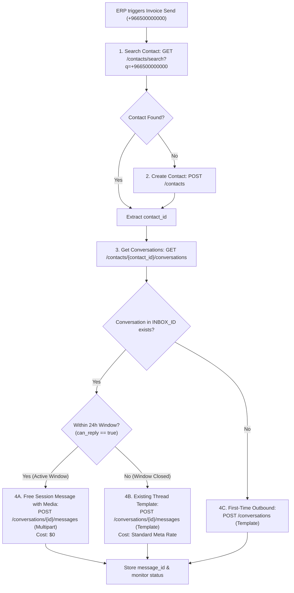

# Raqmi Connect (Chatwoot) — ERP WhatsApp API Integration Guide

This guide is the complete technical reference for integrating an ERP system (e.g., RaqmiERP or external ERPs) with **Raqmi Connect** to send WhatsApp invoice documents, notifications, and customer updates.

It documents the exact API sequence, JSON schemas, 24-hour cost-optimization branching, tokenized PDF handling, and delivery failure tracking.

---

## 1. Quick Architecture & Authentication

### Base Configuration
| Variable | Description | Example |
| :--- | :--- | :--- |
| `BASE_URL` | Raqmi Connect domain | `https://connect.yourdomain.com` |
| `ACCOUNT_ID` | Your Raqmi Connect Account ID | `1` |
| `INBOX_ID` | WhatsApp Inbox ID in Raqmi Connect | `2` |
| `API_TOKEN` | API access token | Found in User Profile / Agent settings |

### Authentication Headers
Every request must include the API token. You can pass it using either header:
```http
api_access_token: <API_TOKEN>
Content-Type: application/json
```
*(Or `Authorization: Bearer <API_TOKEN>`)*

> [!TIP]
> **Least-Privilege Token Security (Inbox Scoping)**:  
> In Raqmi Connect, create a dedicated user with the role **Agent** (not Administrator) and assign that user **only** to the WhatsApp Inbox (under **Settings → Inboxes → Collaborators**). That user's `api_access_token` will be strictly restricted by Pundit policies to that specific inbox.

---

## 2. Decision Flow (Sequence Diagram)

To keep customer messages inside a single conversation thread (identical to native WhatsApp) and maximize cost savings:



---

## 3. Step-by-Step API Specification

### Step 1: Search for Contact
Check if the contact already exists using their phone number in E.164 format.

- **Method**: `GET`
- **URL**: `{{BASE_URL}}/api/v1/accounts/{{ACCOUNT_ID}}/contacts/search?q={{PHONE_NUMBER}}`
- **Example**: `GET https://connect.yourdomain.com/api/v1/accounts/1/contacts/search?q=%2B966500000000`

#### Response (`200 OK`):
```json
{
  "meta": { "count": 1, "current_page": 1, "has_more": false },
  "payload": [
    {
      "id": 142,
      "name": "Ahmed Ali",
      "phone_number": "+966500000000"
    }
  ]
}
```
* **Decision**:
  - If `payload.length > 0`: Extract `contact_id = payload[0].id`.
  - If `payload.length === 0`: Proceed to **Step 2**.

---

### Step 2: Create Contact (If Not Found)
Create the new contact and bind them to the WhatsApp inbox.

- **Method**: `POST`
- **URL**: `{{BASE_URL}}/api/v1/accounts/{{ACCOUNT_ID}}/contacts`

#### Request Body:
```json
{
  "name": "Ahmed Ali",
  "phone_number": "+966500000000",
  "inbox_id": 2,
  "source_id": "+966500000000"
}
```

#### Response (`200 OK`):
```json
{
  "payload": {
    "contact": {
      "id": 143,
      "name": "Ahmed Ali",
      "phone_number": "+966500000000"
    }
  }
}
```
* **Decision**: Extract `contact_id = response.payload.contact.id`.

---

### Step 3: Check Existing Conversations & 24h Window
Retrieve all conversations for the contact to check if a conversation thread already exists in the target WhatsApp inbox.

- **Method**: `GET`
- **URL**: `{{BASE_URL}}/api/v1/accounts/{{ACCOUNT_ID}}/contacts/{{CONTACT_ID}}/conversations`

#### Response (`200 OK`):
```json
{
  "payload": [
    {
      "id": 890,
      "inbox_id": 2,
      "status": "open",
      "can_reply": true
    }
  ]
}
```

#### Decision Rules:
1. Find conversation matching `c.inbox_id === INBOX_ID`.
2. **If match exists AND `can_reply === true`**: The customer messaged you within the last 24 hours. Go to **Step 4A** (Free Session Media Message).
3. **If match exists AND `can_reply === false`**: The customer has a chat history, but the 24h window has closed. Go to **Step 4B** (Reuse Conversation with Template).
4. **If no match exists**: The customer has never messaged this inbox. Go to **Step 4C** (Create First Conversation with Template).

---

### Step 4A: Active 24h Window — Free Session Media Message (Cost: $0)
When `can_reply === true`, you do **not** need an approved template and Meta charges **no template fees**. You can upload the raw invoice PDF binary directly via `multipart/form-data`.

- **Method**: `POST`
- **URL**: `{{BASE_URL}}/api/v1/accounts/{{ACCOUNT_ID}}/conversations/{{CONVERSATION_ID}}/messages`
- **Headers**:
  ```http
  api_access_token: <API_TOKEN>
  Content-Type: multipart/form-data
  ```

#### Multipart Form Fields:
| Field Name | Value | Description |
| :--- | :--- | :--- |
| `content` | text | Document caption (e.g. `"Dear Ahmed, attached is invoice INV-2026-001."`) |
| `message_type` | text | `"outgoing"` |
| `private` | text | `"false"` |
| `echo_id` | text | ERP correlation ID (e.g. `"erp_inv_2026_001"`) |
| `attachments[]` | file | Binary PDF file (`Invoice-INV-2026-001.pdf`) |

#### cURL Example:
```bash
curl -X POST "https://connect.yourdomain.com/api/v1/accounts/1/conversations/890/messages" \
  -H "api_access_token: YOUR_API_TOKEN" \
  -F "content=مرحباً أحمد علي، مرفق فاتورتكم رقم INV-2026-001." \
  -F "message_type=outgoing" \
  -F "private=false" \
  -F "echo_id=inv_2026_001" \
  -F "attachments[]=@/path/to/Invoice-INV-2026-001.pdf"
```

#### Response (`200 OK`):
```json
{
  "id": 10542,
  "conversation_id": 890,
  "status": "sent",
  "echo_id": "inv_2026_001"
}
```
* **Message ID**: `response.id`

---

### Step 4B: Window Closed — Reuse Existing Conversation with Template
When `can_reply === false`, you must send an approved WhatsApp template with the tokenized PDF URL. Posting to the existing conversation ensures the message appears in the same WhatsApp chat.

- **Method**: `POST`
- **URL**: `{{BASE_URL}}/api/v1/accounts/{{ACCOUNT_ID}}/conversations/{{CONVERSATION_ID}}/messages`
- **Headers**:
  ```http
  api_access_token: <API_TOKEN>
  Content-Type: application/json
  ```

#### Request Body:
```json
{
  "content": "مرحباً أحمد علي، مرفق فاتورتكم رقم INV-2026-001.",
  "echo_id": "erp_inv_2026_001",
  "content_attributes": {
    "erp_outbox_id": "outbox_99182"
  },
  "template_params": {
    "name": "invoice_notification",
    "category": "UTILITY",
    "language": "ar",
    "processed_params": {
      "header": {
        "media_type": "document",
        "media_url": "https://erp.yourdomain.com/api/v1/invoices/download?id=INV-2026-001&token=sec_abc123",
        "media_name": "Invoice-INV-2026-001.pdf"
      },
      "body": {
        "1": "أحمد علي",
        "2": "INV-2026-001"
      }
    }
  }
}
```
*(Note: If your template in Meta uses named parameters instead of numbers, use `"body": { "customer_name": "أحمد علي", "invoice_no": "INV-2026-001" }`)*

#### Response (`200 OK`):
```json
{
  "id": 10543,
  "conversation_id": 890,
  "status": "sent",
  "echo_id": "erp_inv_2026_001"
}
```
* **Message ID**: `response.id`

---

### Step 4C: First-Time Contact — Initialize Conversation with Template
When no conversation exists for the contact in this inbox, create the conversation thread and dispatch the template message in one API call.

- **Method**: `POST`
- **URL**: `{{BASE_URL}}/api/v1/accounts/{{ACCOUNT_ID}}/conversations`

#### Request Body:
```json
{
  "inbox_id": 2,
  "contact_id": 143,
  "source_id": "+966500000000",
  "message": {
    "content": "مرحباً أحمد علي، مرفق فاتورتكم رقم INV-2026-001.",
    "echo_id": "erp_inv_2026_001",
    "content_attributes": {
      "erp_outbox_id": "outbox_99182"
    },
    "template_params": {
      "name": "invoice_notification",
      "category": "UTILITY",
      "language": "ar",
      "processed_params": {
        "header": {
          "media_type": "document",
          "media_url": "https://erp.yourdomain.com/api/v1/invoices/download?id=INV-2026-001&token=sec_abc123",
          "media_name": "Invoice-INV-2026-001.pdf"
        },
        "body": {
          "1": "أحمد علي",
          "2": "INV-2026-001"
        }
      }
    }
  }
}
```

#### Response (`200 OK`):
```json
{
  "id": 891,
  "inbox_id": 2,
  "status": "open",
  "messages": [
    {
      "id": 10544,
      "conversation_id": 891,
      "status": "sent",
      "echo_id": "erp_inv_2026_001"
    }
  ]
}
```
* **Message ID**: `response.messages[0].id`
* **Conversation ID**: `response.id`

---

## 4. Invoice PDF Serving Options (When Outside 24h Window)

Meta’s WhatsApp Cloud API requires an HTTPS URL to fetch the PDF header for templates. The file **does NOT need to be permanently public**.

### Option A: Tokenized ERP Endpoint (Recommended if ERP is on a public domain)
1. ERP exposes a download route:  
   `https://erp.yourdomain.com/api/v1/invoices/download?id=INV-1024&token=d83f7a2...`
2. Token is an expiring HMAC hash of Invoice ID + Secret Key.
3. Invalidate the token after 1 hour or after 2 successful downloads by Meta.

### Option B: Pre-Signed Object Storage URL (AWS S3 / Cloudflare R2 / MinIO)
1. ERP uploads the generated PDF directly to a private bucket.
2. ERP generates a pre-signed download URL valid for 15 minutes.
3. Pass the pre-signed URL as `media_url`. Once Meta downloads and caches the PDF, the customer has it permanently in WhatsApp, even after the link expires.

---

## 5. Delivery Tracking, Error Handling & Anti-Duplicate Safety

### `SendReplyJob` Non-Retrying Guarantee
Raqmi Connect has built-in protections against duplicate message dispatches:
1. **`source_id` Check**: If a message already has a `source_id` assigned by Meta, no dispatch is attempted.
2. **No Sidekiq Retries**: Under any network exception or API failure, Sidekiq will **never retry** the dispatch.
3. **Dispatch Marker & Exception Categorization**:
   - Before making an HTTP call to Meta, a `dispatch_started_at` timestamp (UTC ISO-8601) is committed to `content_attributes`.
   - Any exception occurring **before** the marker was committed:  
     Status is set to `failed` with `external_error: "DISPATCH_NOT_SENT: <class>"`.
   - Any exception occurring **after** the marker was committed:  
     Status is set to `failed` with `external_error: "DISPATCH_UNKNOWN: <class>: <message>"`.
   - If a dispatch attempt encounters an existing `dispatch_started_at` marker and a blank `source_id`, the message is not resent and is marked `failed` with `external_error: "DISPATCH_UNKNOWN: interrupted dispatch"`.

### Meta Billing Guarantee for Failed Messages
* **Meta WhatsApp Cloud API charges only upon successful delivery (`status: delivered`)**.
* Messages that fail (e.g., PDF download failure `131053`, phone not on WhatsApp `131026`, or network timeouts) **incur $0 charge**.
* Resending after a confirmed failure will **not** cause double billing.

### Webhook Event (`message_updated`)
Configure an incoming webhook endpoint in Raqmi Connect (**Settings → Integrations → Webhooks**).

#### Failure Webhook Payload:
```json
{
  "event": "message_updated",
  "id": 10542,
  "conversation": { "id": 890 },
  "status": "failed",
  "content_attributes": {
    "erp_outbox_id": "outbox_99182",
    "external_error": "DISPATCH_NOT_SENT: Net::OpenTimeout"
  }
}
```

#### Success Delivery Webhook Payload:
```json
{
  "event": "message_updated",
  "id": 10542,
  "conversation": { "id": 890 },
  "status": "delivered",
  "content_attributes": {
    "erp_outbox_id": "outbox_99182",
    "external_error": null
  }
}
```

---

## 6. Complete Drop-in TypeScript / Node.js Implementation

```typescript
import axios from 'axios';
import FormData from 'form-data';
import fs from 'fs';

export interface SendInvoiceRequest {
  customerName: string;
  phoneNumber: string;       // E.164: +966500000000
  invoiceNumber: string;
  pdfFilePath: string;       // Local disk path for 24h window multipart upload
  pdfTokenizedUrl: string;   // HTTPS URL for template header when 24h window is closed
  erpOutboxId: string;
}

const client = axios.create({
  baseURL: process.env.RAQMI_CONNECT_URL,
  headers: {
    api_access_token: process.env.RAQMI_API_TOKEN,
  },
});

const ACCOUNT_ID = Number(process.env.RAQMI_ACCOUNT_ID);
const INBOX_ID = Number(process.env.RAQMI_WHATSAPP_INBOX_ID);

export async function dispatchInvoice(req: SendInvoiceRequest) {
  // 1. Search Contact
  const searchRes = await client.get(`/api/v1/accounts/${ACCOUNT_ID}/contacts/search`, {
    params: { q: req.phoneNumber },
  });

  let contactId: number;
  if (searchRes.data.payload && searchRes.data.payload.length > 0) {
    contactId = searchRes.data.payload[0].id;
  } else {
    // 2. Create Contact if not found
    const createRes = await client.post(`/api/v1/accounts/${ACCOUNT_ID}/contacts`, {
      name: req.customerName,
      phone_number: req.phoneNumber,
      inbox_id: INBOX_ID,
      source_id: req.phoneNumber,
    });
    contactId = createRes.data.payload.contact.id;
  }

  // 3. Find Existing Conversation in this WhatsApp inbox
  const convRes = await client.get(`/api/v1/accounts/${ACCOUNT_ID}/contacts/${contactId}/conversations`);
  const existingConv = convRes.data.payload?.find((c: any) => c.inbox_id === INBOX_ID);

  // 4. Branch based on 24h Window and Conversation Existence
  const is24hWindowOpen = existingConv && existingConv.can_reply === true;

  if (is24hWindowOpen) {
    // -----------------------------------------------------------------
    // BRANCH A: ACTIVE 24H WINDOW -> FREE SESSION MESSAGE WITH MEDIA
    // -----------------------------------------------------------------
    const form = new FormData();
    form.append('content', `مرحباً ${req.customerName}، مرفق فاتورتكم رقم ${req.invoiceNumber}.`);
    form.append('message_type', 'outgoing');
    form.append('private', 'false');
    form.append('echo_id', req.erpOutboxId);
    form.append('attachments[]', fs.createReadStream(req.pdfFilePath), {
      filename: `Invoice-${req.invoiceNumber}.pdf`,
      contentType: 'application/pdf',
    });

    const res = await client.post(
      `/api/v1/accounts/${ACCOUNT_ID}/conversations/${existingConv.id}/messages`,
      form,
      { headers: form.getHeaders() }
    );

    return { mode: 'free_session_media', messageId: res.data.id, conversationId: existingConv.id };
  } else {
    // -----------------------------------------------------------------
    // BRANCH B: 24H WINDOW CLOSED -> APPROVED WHATSAPP TEMPLATE
    // -----------------------------------------------------------------
    const templateMessage = {
      content: `مرحباً ${req.customerName}، مرفق فاتورتكم رقم ${req.invoiceNumber}.`,
      echo_id: req.erpOutboxId,
      content_attributes: {
        erp_outbox_id: req.erpOutboxId,
      },
      template_params: {
        name: 'invoice_notification',
        category: 'UTILITY',
        language: 'ar',
        processed_params: {
          header: {
            media_type: 'document',
            media_url: req.pdfTokenizedUrl,
            media_name: `Invoice-${req.invoiceNumber}.pdf`,
          },
          body: {
            '1': req.customerName,
            '2': req.invoiceNumber,
          },
        },
      },
    };

    if (existingConv) {
      // Reuse existing conversation thread
      const res = await client.post(
        `/api/v1/accounts/${ACCOUNT_ID}/conversations/${existingConv.id}/messages`,
        templateMessage,
        { headers: { 'Content-Type': 'application/json' } }
      );
      return { mode: 'template_existing_conv', messageId: res.data.id, conversationId: existingConv.id };
    } else {
      // First-time conversation creation
      const res = await client.post(
        `/api/v1/accounts/${ACCOUNT_ID}/conversations`,
        {
          inbox_id: INBOX_ID,
          contact_id: contactId,
          source_id: req.phoneNumber,
          message: templateMessage,
        },
        { headers: { 'Content-Type': 'application/json' } }
      );
      return {
        mode: 'template_new_conv',
        messageId: res.data.messages[0].id,
        conversationId: res.data.id,
      };
    }
  }
}
```
