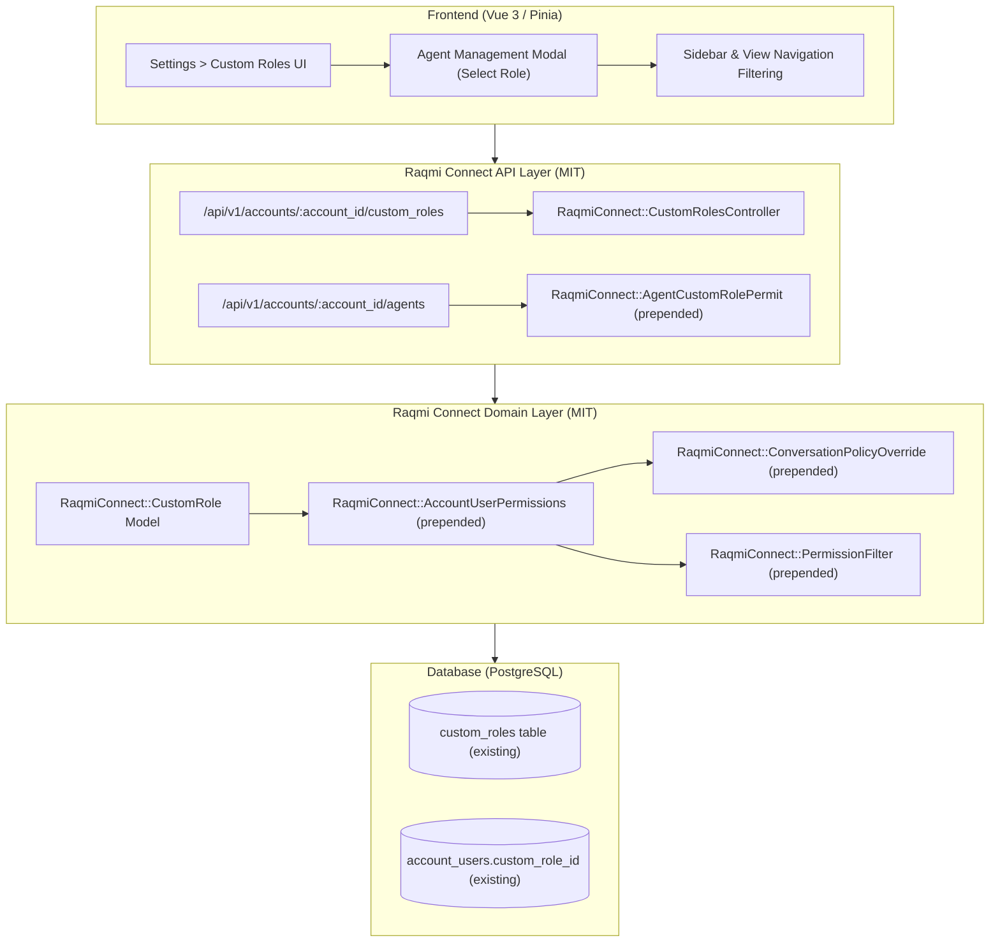

# Implementation Plan: MIT-Compliant Custom Roles in Raqmi Connect

## 1. Overview & Objectives

The goal is to provide a complete **Custom Roles & Permissions** system within the **Raqmi Connect** fork that is **100% compliant with the root MIT License**, without altering the database schema and without executing or relying on proprietary code located in `enterprise/`.

### Key Principles & Constraints
- **Zero Database Schema Changes**: Utilize the existing `custom_roles` table and `account_users.custom_role_id` column present in the MIT schema ([`db/schema.rb`](../db/schema.rb)).
- **Zero Upstream Ruby File Edits**: Follow [`docs/FORK.md`](./FORK.md) and [`AGENTS.md`](../AGENTS.md). All backend behavior lives in `app/**/raqmi_connect/` using `prepend` + `super`, wired via [`config/initializers/raqmi_connect.rb`](../config/initializers/raqmi_connect.rb).
- **Clean License Boundary**: Must function fully even when `DISABLE_ENTERPRISE=true` is set or if the `enterprise/` directory is omitted.
- **Frontend Isolation**: Upstream edits are strictly confined to permitted files in [`docs/FORK.md`](./FORK.md).

---

## 2. Architecture & Design



---

## 3. Implementation Phases

### Phase 1: Domain & Model Layer (MIT-owned)

1. **Create Model `app/models/raqmi_connect/custom_role.rb`**:
   - Inherits from `ApplicationRecord`, setting `self.table_name = 'custom_roles'`.
   - Alias or define top-level constant `CustomRole = RaqmiConnect::CustomRole` if not already defined (or when enterprise is disabled).
   - Associations:
     - `belongs_to :account`
     - `has_many :account_users, dependent: :nullify`
   - Supported permissions constants:
     - `conversation_manage`
     - `conversation_unassigned_manage`
     - `conversation_participating_manage`
     - `contact_manage`
     - `report_manage`
     - `knowledge_base_manage`
     *(Plus optional fork extensions, e.g., `inbox_manage`, `campaign_manage`).*
   - Validations: presence and uniqueness of `name` within account scope; inclusion validation for `permissions`.
   - Unread count visibility invalidation callbacks (`FilteredCountInvalidator`).

2. **Prepend `RaqmiConnect::AccountCustomRoleExtension` to `Account`** (`app/models/raqmi_connect/account_custom_role_extension.rb`):
   - `has_many :custom_roles, class_name: 'RaqmiConnect::CustomRole', dependent: :destroy_async`

3. **Prepend `RaqmiConnect::AccountUserCustomRole` to `AccountUser`** (`app/models/raqmi_connect/account_user_custom_role.rb`):
   - `belongs_to :custom_role, class_name: 'RaqmiConnect::CustomRole', optional: true`
   - Override `permissions`:
     ```ruby
     def permissions
       return custom_role.permissions + ['custom_role'] if custom_role.present?
       super
     end
     ```
   - Invalidate conversation visibility/cache when `custom_role_id` changes.

---

### Phase 2: API & Controller Layer

1. **Create Controller `app/controllers/raqmi_connect/custom_roles_controller.rb`**:
   - Inherits from `Api::V1::Accounts::BaseController`.
   - Actions:
     - `index`: List all custom roles for `Current.account`.
     - `show`: Details for a specific role.
     - `create`: Create a custom role with `permitted_params` (`:name`, `:description`, `permissions: []`).
     - `update`: Update attributes and permissions.
     - `destroy`: Delete role and nullify assigned agents.
   - Authorization: Ensure `Current.account_user.administrator?`.

2. **Prepend `RaqmiConnect::AgentsControllerCustomRole` to `Api::V1::Accounts::AgentsController`** (`app/controllers/raqmi_connect/agents_controller_custom_role.rb`):
   - Allow `custom_role_id` in agent update/create attributes:
     - Overrides `account_user_attributes` to append `:custom_role_id`.
     - On create/update, update `current_account_user.update!(custom_role_id: params[:custom_role_id])`.

3. **Wire Routes in `config/initializers/raqmi_connect.rb`**:
   - Map `api/v1/accounts/:account_id/custom_roles` to `/raqmi_connect/custom_roles`.

4. **JSON Serialization Views**:
   - Create Jbuilder templates under `app/views/raqmi_connect/custom_roles/`:
     - `index.json.jbuilder`, `show.json.jbuilder`, `create.json.jbuilder`, `update.json.jbuilder`
   - Prepend `app/views/api/v1/models/_account_user.json.jbuilder` to include `custom_role_id` and `custom_role` summary so the frontend receives the agent's role details.

---

### Phase 3: Authorization & Conversation Filtering

1. **Prepend `RaqmiConnect::ConversationPolicyPermissions` to `ConversationPolicy`** (`app/policies/raqmi_connect/conversation_policy_permissions.rb`):
   - Extend `show?`:
     - Administrators always have access.
     - Plain agents fall back to `super`.
     - Agents with `custom_role` are checked against their specific permissions:
       - `conversation_manage` -> allow.
       - `conversation_unassigned_manage` -> allow if unassigned or assigned to self.
       - `conversation_participating_manage` -> allow if assigned to self or participant.

2. **Prepend `RaqmiConnect::ConversationFilterPermissions` to conversation list services** (`app/services/raqmi_connect/conversation_filter_permissions.rb`):
   - Filter conversation feeds (Mine / Unassigned / All) so agents with restricted roles only see conversations they have permission to access.

3. **Policies for Contacts and Reports**:
   - Prepend `ContactPolicy` and `ReportPolicy` to grant read/write access based on `contact_manage` and `report_manage` permissions.

---

### Phase 4: Frontend Adjustments (Permitted Fork Files)

1. **Unlock Community Installation Type in Route**:
   - In `app/javascript/dashboard/routes/dashboard/settings/customRoles/customRole.routes.js`, add `INSTALLATION_TYPES.COMMUNITY` to `installationTypes`.
2. **Bypass Enterprise Paywall Component**:
   - In `app/javascript/dashboard/routes/dashboard/settings/customRoles/Index.vue`, allow the table and modal when the feature is enabled or when `isACustomBrandedInstance` is true.
3. **Verify Agent Settings UI**:
   - Verify that `AddAgent.vue` and `EditAgent.vue` populate the Custom Role dropdown from the new MIT-backed API.

---

## 5. Verification & Testing Strategy

1. **Automated Fork Specs (`bundle exec rspec spec/**/*_raqmi_connect_spec.rb`)**:
   - `spec/models/raqmi_connect/custom_role_spec.rb`:
     - Test role creation, validations, permission arrays, and nullification on agent deletion.
   - `spec/controllers/raqmi_connect/custom_roles_controller_spec.rb`:
     - Test CRUD permissions: admin access allowed, agent access rejected with 403/Pundit error.
   - `spec/controllers/raqmi_connect/agents_controller_custom_role_spec.rb`:
     - Test assigning and removing `custom_role_id` for agents.
   - `spec/policies/raqmi_connect/conversation_policy_spec.rb`:
     - Test `conversation_manage`, `conversation_unassigned_manage`, and `conversation_participating_manage`.
2. **License Isolation Test**:
   - Run the suite with `DISABLE_ENTERPRISE=true` to prove zero dependency on any code in `enterprise/`.
3. **Manual Functional Verification**:
   - Create custom role with specific permissions (e.g. `conversation_participating_manage`).
   - Assign role to an agent.
   - Verify agent can only see/manage assigned/participating conversations.
   - Verify agent cannot access reports or contacts if those permissions are excluded.

---

## 6. Risk Assessment & Mitigation

| Potential Risk | Impact | Mitigation Strategy |
| :--- | :--- | :--- |
| **Name collision with `enterprise/app/models/custom_role.rb`** | High | Namespace all fork models under `RaqmiConnect::` and conditionally alias or load based on `ChatwootApp.enterprise?` / `DISABLE_ENTERPRISE`. |
| **Upstream merge conflicts** | Low | Follow `docs/FORK.md` rule: 100% of Ruby logic in `app/**/raqmi_connect/` prepended via initializer. Upstream merges cannot conflict with fork-owned files. |
| **Unread count cache staleness** | Medium | Implement the unread count invalidation hook in the prepended `AccountUser` and `CustomRole` models to mirror standard Chatwoot behavior. |
