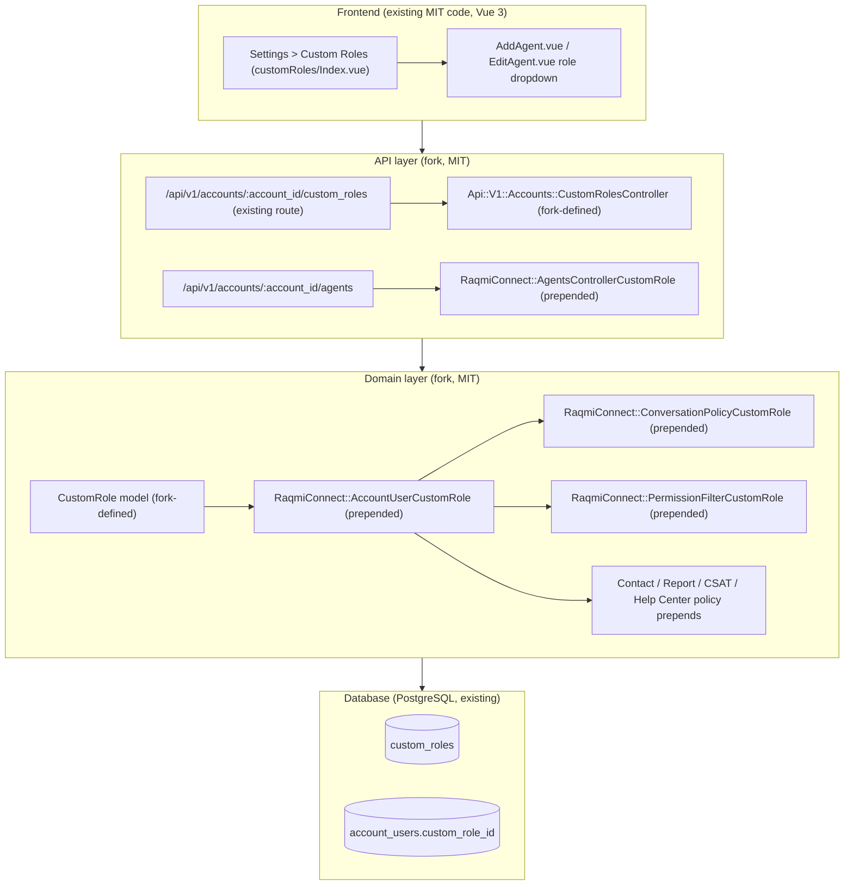

# Implementation Plan: MIT-Compliant Custom Roles in Raqmi Connect

## 1. Overview & Objectives

Provide a complete **Custom Roles & Permissions** backend in the Raqmi Connect fork that is **100% under the root
MIT License**: no database schema changes, and no execution of, dependency on, or adaptation of code under
`enterprise/`.

The frontend (settings page, store, API client, agent role dropdown) and the data model already exist outside
`enterprise/`. Only the backend is enterprise-only today, so this plan supplies an MIT backend behind the existing
MIT contract.

### Key Principles & Constraints
- **Zero Database Schema Changes**: use the existing `custom_roles` table and `account_users.custom_role_id`
  column in [`db/schema.rb`](../db/schema.rb).
- **Fork rules**: follow [`docs/FORK.md`](./FORK.md) and [`AGENTS.md`](../AGENTS.md). Backend behaviour lives in
  `app/**/raqmi_connect/` (plus the controller in §3.2.1), added with `prepend` + `super` and wired in
  [`config/initializers/raqmi_connect.rb`](../config/initializers/raqmi_connect.rb).
- **Fork backend only when enterprise is off**: every class, prepend and association in this plan is registered
  only when `!ChatwootApp.enterprise?`. Production runs with `DISABLE_ENTERPRISE=true` (see §2.2).
- **Clean room**: see §2.3.
- **Upstream edits are listed**: every upstream file this plan edits is added to "Upstream files we still edit" in
  FORK.md (§3.5).

---

## 2. Architecture & Design



### 2.1 Contract we implement (all already in MIT code)

| Source | What it fixes |
|---|---|
| `config/routes.rb:173` | `resources :custom_roles, only: [:index, :create, :show, :update, :destroy]` → `Api::V1::Accounts::CustomRolesController` |
| `app/javascript/dashboard/api/customRole.js`, `store/modules/customRole.js` and its specs/fixtures | Request and response shape of the CRUD API |
| `EditAgent.vue:131-135`, `AddAgent.vue` | `custom_role_id` is sent as a **top-level** param on agent create/update; `null` clears it |
| `app/views/api/v1/models/_agent.json.jbuilder:14` | Agent payload carries `custom_role_id` |
| `app/views/api/v1/models/_user.json.jbuilder:3,44,51` | Profile payload carries `account_user.permissions` (drives frontend route `permissions` meta) and renders `_account_user` partial |
| `app/services/conversations/unread_counts/counter.rb` | Permission names `conversation_manage`, `conversation_unassigned_manage`, `conversation_participating_manage`; a custom role applies only when `account_user.agent? && custom_role_id.present?` |
| `lib/seeders/seed_data.yml`, `spec/factories/custom_roles.rb` | Remaining permission names and sample roles |

### 2.2 Enterprise on vs. off

Enterprise already defines `::CustomRole`, `CustomRolePolicy`, `Api::V1::Accounts::CustomRolesController`,
`Account has_many :custom_roles`, an `AccountUser#permissions` override, and its own prepend to
`Conversations::PermissionFilterService`. Loading both would double-filter, double-authorize and redefine
associations.

Rule: **the fork backend activates only when `ChatwootApp.enterprise?` is false.** The `enterprise/` code and
the fork code never run together.

- Fork constants that must have upstream's top-level names (`CustomRole`, `CustomRolePolicy`,
  `Api::V1::Accounts::CustomRolesController`) live in files under `app/**/raqmi_connect/` and are defined by the
  initializer only when enterprise is off (e.g. `RaqmiConnect::CustomRole` assigned to `::CustomRole` with
  `Object.const_set` unless `Object.const_defined?(:CustomRole, false)`).
- `docs/raqmiconnect-deployment.md` documents `DISABLE_ENTERPRISE=true` as **required** for production, and
  says the Docker image may omit `enterprise/` entirely.
- On boot with enterprise on, the initializer logs one line saying fork custom roles are inactive.

### 2.3 Clean-room rule

The implementer builds from the MIT contract in §2.1 and this plan only. They **do not read, copy or adapt**
files under `enterprise/` or `spec/enterprise/`. Behaviour questions are answered from MIT code, the frontend,
or by running it. File names that match enterprise ones (jbuilder action names, `custom_role.rb`) come from
Rails conventions and the existing route, not from enterprise sources. Reviewers check this on the PR.

---

## 3. Implementation Phases

### Phase 1: Domain & Model Layer

1. **`app/models/raqmi_connect/custom_role.rb`** (`RaqmiConnect::CustomRole`, aliased to `::CustomRole` per §2.2)
   - `self.table_name = 'custom_roles'`
   - `belongs_to :account`; `has_many :account_users, dependent: :nullify`
   - `PERMISSIONS = %w[conversation_manage conversation_unassigned_manage conversation_participating_manage
     contact_manage report_manage knowledge_base_manage].freeze`. Fork-only additions (e.g. `inbox_manage`)
     are out of scope for v1; adding one later also needs a matching frontend permission.
   - Validations: `name` present and unique per `account_id`; every entry of `permissions` in `PERMISSIONS`.
   - Cache: after save (if `permissions` changed) and after destroy, call
     `Conversations::UnreadCounts::FilteredCountInvalidator` for each affected `account_users.user_id`, then
     dispatch `ACCOUNT_CACHE_INVALIDATED`. Collect the user IDs **before** destroy, since `:nullify` clears them.
     Changes to an agent's own `custom_role_id` are already invalidated by upstream `AccountUser`
     (`filtered_unread_count_visibility_changed?`), so no code is needed for that.

2. **`RaqmiConnect::AccountCustomRoles`** → `Account` (`app/models/raqmi_connect/account_custom_roles.rb`)
   - `extend ActiveSupport::Concern` with `prepended do has_many :custom_roles, dependent: :destroy_async end`.
     Association macros in a plain prepended module never run.

3. **`RaqmiConnect::AccountUserCustomRole`** → `AccountUser` (`app/models/raqmi_connect/account_user_custom_role.rb`)
   - `prepended do belongs_to :custom_role, optional: true end`
   - Override `permissions` and keep the admin path:
     ```ruby
     def permissions
       return super unless agent? && custom_role.present?

       custom_role.permissions + ['custom_role']
     end
     ```
     An administrator with a leftover `custom_role_id` still gets `['administrator']`.
   - Add `custom_role_agent?` (`agent? && custom_role_id.present?`) and `custom_role_permission?(name)` helpers
     for the policies and the filter.

---

### Phase 2: API & Controller Layer

1. **`Api::V1::Accounts::CustomRolesController`**, defined from
   `app/controllers/raqmi_connect/custom_roles_controller.rb` and bound to the top-level constant per §2.2, so
   the **existing** route at `config/routes.rb:173` dispatches to it. No new route is drawn: appended routes lose
   to that line, and a second definition would make the route table ambiguous.
   - Inherits `Api::V1::Accounts::BaseController`; `before_action :check_authorization` → `CustomRolePolicy`.
   - `index`, `show`, `create`, `update`, `destroy` scoped to `Current.account.custom_roles`.
   - Params: `params.require(:custom_role).permit(:name, :description, permissions: [])`. Match the key and shape
     to `api/customRole.js` and the store fixtures.
   - Views in `app/views/raqmi_connect/custom_roles/` (`index`, `show`, `create`, `update`) plus a
     `_custom_role` partial; render them with an explicit `template:`, since the controller's implied view path is
     `api/v1/accounts/custom_roles`.

2. **`CustomRolePolicy`** (`app/policies/raqmi_connect/custom_role_policy.rb`, aliased per §2.2): every action is
   `account_user.administrator?`.

3. **`RaqmiConnect::AgentsControllerCustomRole`** → `Api::V1::Accounts::AgentsController`
   (`app/controllers/raqmi_connect/agents_controller_custom_role.rb`)
   - The frontend sends `custom_role_id` at the top level, so **do not** add it to `account_user_attributes`
     (that only permits `params[:agent][...]`). `AgentBuilder` doesn't take it either.
   - Override `create` and `update` with `super`, then `assign_custom_role` (skip on create if `@agent` is blank,
     e.g. after a payment-required render). Assign only when the `custom_role_id` key is present:
     ```ruby
     def assign_custom_role
       return unless params.key?(:custom_role_id)

       role = params[:custom_role_id].presence && Current.account.custom_roles.find(params[:custom_role_id])
       @agent.current_account_user.update!(custom_role_id: role&.id)
     end
     ```
     Looking the ID up through `Current.account.custom_roles` stops an admin attaching another account's role
     (raises `RecordNotFound` → 404). A blank value clears the role. Assigning a role while the `custom_roles`
     feature is off for the account is rejected; clearing is always allowed.
   - Relies on upstream `create`, `update`, `@agent`, and `User#current_account_user` (list these in FORK.md).

4. **Agent and profile payloads**: `_agent.json.jbuilder:14` and `_user.json.jbuilder:3,51` include custom role data
   only `if ChatwootApp.enterprise?`, so with enterprise off `EditAgent` never gets `customRoleId`, and the
   account payload never receives `custom_role_id` or `custom_role`. Furthermore, `_account_user.json.jbuilder`
   only exists inside `enterprise/`. Views can't be prepended, so edit the guard expressions in both partials to
   test for the association, and provide an OSS partial:
   - `_agent.json.jbuilder:14`: `… if AccountUser.reflect_on_association(:custom_role)`
   - `_user.json.jbuilder:3`: `account_users = account_users.includes(:custom_role) if AccountUser.reflect_on_association(:custom_role)`
   - `_user.json.jbuilder:51`: `json.partial! 'api/v1/models/account_user', account_user: account_user if AccountUser.reflect_on_association(:custom_role)`
   - Create `app/views/api/v1/models/_account_user.json.jbuilder` (fork-owned, in root OSS tree):
     ```ruby
     json.custom_role_id account_user&.custom_role_id
     json.custom_role account_user&.custom_role&.as_json(only: [:id, :name, :description, :permissions])
     ```

   Behaviour with enterprise on is unchanged. Both edited upstream partials go on FORK.md's "Upstream files we still edit" list.

---

### Phase 3: Authorization & Conversation Filtering

Every rule below applies only when `account_user.custom_role_agent?`. Administrators and plain agents always go
through `super`, so upstream behaviour is unchanged for them.

1. **`RaqmiConnect::ConversationPolicyCustomRole`** → `ConversationPolicy`
   - `show?`: administrator / agent bot → `super`. Custom-role agent → must also have inbox or team access (the
     upstream `agent_can_view_conversation?` check), and then:
     - `conversation_manage` → allow
     - `conversation_unassigned_manage` → allow if `assignee_id` is nil or `assigned_to_user?`
     - `conversation_participating_manage` → allow if `assigned_to_user?` or `participant?`
     - none of the three → deny
   - Scope: conversation sub-resources (messages, assignments, labels, participants, etc.) authorize through
     `Api::V1::Accounts::Conversations::BaseController#conversation` → `authorize @conversation, :show?`, as do
     `ConversationsController#conversation` and the Dyte/Stripe integrations, so gating `show?` covers updates and
     actions too. `destroy?` stays administrator-only. The spec asserts a denied agent is refused (Pundit →
     401 in this app) on `messages#create` and `assignments#create`, not only on `show`.
   - Relies on upstream private `agent_can_view_conversation?`, `assigned_to_user?`, `participant?`.

2. **`RaqmiConnect::PermissionFilterCustomRole`** → `Conversations::PermissionFilterService`
   - Override `perform`: custom-role agent → apply the same three rules as a relation on top of `super`'s
     inbox-scoped result (`super.where(assignee_id: [nil, user.id])` for unassigned, and an `assignee_id = user`
     OR `EXISTS conversation_participants` clause for participating). No conversation permission → `.none`.
   - This service feeds the Mine / Unassigned / All lists, filters and search. Unread counts are computed
     separately by `UnreadCounts::Counter`, which already applies these rules, so lists and badges agree.
   - Relies on upstream `perform`, `user`, `account`, private `account_user`.

3. **Other policies**: each one prepends to the upstream policy and falls back to `super` for non-custom-role users.

   | Permission | Policy (upstream) | Custom-role agent behaviour |
   |---|---|---|
   | `contact_manage` | `ContactPolicy` (upstream allows agents everything except import/export) | **Restrict**: without `contact_manage`, deny `index?`, `active?`, `search?`, `filter?`, `show?`, `update?`, `destroy_custom_attributes?`, `contactable_inboxes?`, and the rest of the public actions. With it, `super`. Import/export stay administrator-only. |
   | `report_manage` | `ReportPolicy#view?` (upstream: admin only) | **Grant**: allow `view?` with `report_manage`. |
   | `report_manage` | `CsatSurveyResponsePolicy` (`index?`, `metrics?`, `download?`) | **Grant** the same way. |
   | `knowledge_base_manage` | `PortalPolicy`, `ArticlePolicy`, `CategoryPolicy` | **Grant** with `knowledge_base_manage`. Without it, deny all actions for custom-role agents. Check each upstream method's current rule before overriding, and only widen or narrow what the table says. |

   Before writing each prepend, list the upstream policy's public methods. Any method not covered above is listed
   in the PR and decided explicitly. A method left to `super` by accident is a permission hole.

---

### Phase 4: Feature Flag & Frontend

1. **Feature flag**: `custom_roles` is `premium: true, enabled: false` in `config/features.yml`. The settings
   route (`featureFlag: CUSTOM_ROLES`) and the `Index.vue` paywall both read it. Add a fork-owned rake task
   `raqmi_connect:enable_custom_roles[account_id]` in `lib/tasks/raqmi_connect.rake` that calls
   `Account#enable_features!('custom_roles')` (one account, or all accounts if the ID is omitted). Also check
   whether the Super Admin account features page lets you toggle premium features on a community install. If it
   does, document it as the per-account alternative. Assigning a role is blocked while the flag is off (§3.2.3).
2. **Installation type**: in `customRoles/customRole.routes.js`, add `INSTALLATION_TYPES.COMMUNITY` to
   `installationTypes`. With enterprise disabled, the installation reports as community, so the route would
   otherwise be hidden.
3. **Paywall**: with the flag on, `isBehindAPaywall` in `Index.vue` is false and the table and modal render.
   No `Index.vue` edit is expected. Make one only if manual testing shows another gate, and then add the file to
   FORK.md.
4. **Sidebar**: the "Custom Roles" entry in `components-next/sidebar/Sidebar.vue` (around line 941) is
   resolved through the route meta, so it appears once the route allows `COMMUNITY`. Verify; no edit expected.
5. **Agent UI**: verify `AddAgent.vue` / `EditAgent.vue` list roles from the store and round-trip
   `custom_role_id` (needs §3.2.4).

---

### Phase 5: Wiring & Docs

1. **`config/initializers/raqmi_connect.rb`**, inside the existing `to_prepare` block:
   ```ruby
   unless ChatwootApp.enterprise?
     Object.const_set(:CustomRole, RaqmiConnect::CustomRole) unless Object.const_defined?(:CustomRole, false)
     # … same for CustomRolePolicy and Api::V1::Accounts::CustomRolesController
     Account.prepend(RaqmiConnect::AccountCustomRoles)
     AccountUser.prepend(RaqmiConnect::AccountUserCustomRole)
     Api::V1::Accounts::AgentsController.prepend(RaqmiConnect::AgentsControllerCustomRole)
     ConversationPolicy.prepend(RaqmiConnect::ConversationPolicyCustomRole)
     Conversations::PermissionFilterService.prepend(RaqmiConnect::PermissionFilterCustomRole)
     ContactPolicy.prepend(RaqmiConnect::ContactPolicyCustomRole)
     ReportPolicy.prepend(RaqmiConnect::ReportPolicyCustomRole)
     CsatSurveyResponsePolicy.prepend(RaqmiConnect::CsatSurveyResponsePolicyCustomRole)
     PortalPolicy.prepend(RaqmiConnect::HelpCenterPolicyCustomRole)
     ArticlePolicy.prepend(RaqmiConnect::HelpCenterPolicyCustomRole)
     CategoryPolicy.prepend(RaqmiConnect::HelpCenterPolicyCustomRole)
   end
   ```
   No route changes.
2. **`docs/FORK.md`**:
   - Add a row to "Behaviour added by prepend" for each module above, with the upstream methods it relies on
     (from each phase's "Relies on" notes).
   - Add the fork-defined top-level constants to a short "Constants defined when enterprise is off" note.
   - Add to "Upstream files we still edit": `customRoles/customRole.routes.js`, `_agent.json.jbuilder`,
     `_user.json.jbuilder` (and `Index.vue` only if Phase 4.3 needed it).
   - Add `lib/tasks/raqmi_connect.rake` and `app/views/api/v1/models/_account_user.json.jbuilder` to fork-owned files.
3. **`docs/raqmiconnect-deployment.md`**: make `DISABLE_ENTERPRISE=true` required and explain why (§2.2), and add
   the step to enable the `custom_roles` flag.

---

## 4. Verification & Testing Strategy

1. **Fork specs.** All names end in `_raqmi_connect_spec.rb` so the FORK.md glob
   (`bundle exec rspec spec/**/*_raqmi_connect_spec.rb`) picks them up:
   - `spec/models/raqmi_connect/custom_role_raqmi_connect_spec.rb`: validations (name uniqueness per account,
     unknown permission rejected), nullify on destroy, cache invalidation on permission change and destroy.
   - `spec/models/raqmi_connect/account_user_custom_role_raqmi_connect_spec.rb`: `permissions` for a custom-role
     agent, a plain agent, and an **administrator with a `custom_role_id`** (must stay `['administrator']`).
   - `spec/controllers/raqmi_connect/custom_roles_controller_raqmi_connect_spec.rb`: admin CRUD; agent → 401;
     another account's role → 404.
   - `spec/controllers/raqmi_connect/agents_controller_custom_role_raqmi_connect_spec.rb`: assign on create and
     update via top-level `custom_role_id`; clear with `null`; key omitted leaves role unchanged; **another
     account's role → 404 and no change**; assignment refused while the feature flag is off.
   - `spec/policies/raqmi_connect/conversation_policy_custom_role_raqmi_connect_spec.rb`: each of the three
     permissions plus "none"; inbox access still required; admin and plain agent unchanged.
   - `spec/requests/raqmi_connect/conversation_access_custom_role_raqmi_connect_spec.rb`: a denied agent is refused (401)
     on `messages#create` and `assignments#create`.
   - `spec/services/raqmi_connect/permission_filter_custom_role_raqmi_connect_spec.rb`: list results match the
     policy for each permission, and match `UnreadCounts::Counter` totals.
   - `spec/policies/raqmi_connect/{contact,report,csat_survey_response,help_center}_policy_custom_role_raqmi_connect_spec.rb`:
     the grant/restrict table in §3.3.3.
   - `spec/views/raqmi_connect/agent_payload_raqmi_connect_spec.rb`: agent JSON includes `custom_role_id` with
     enterprise off.
2. **License isolation**: run the fork specs with `DISABLE_ENTERPRISE=true`, and once in a checkout with
   `enterprise/` deleted, to prove there's no dependency on it. Also boot with enterprise **on** and check that
   the fork modules are not prepended (one spec on `AccountUser.ancestors`).
3. **Upstream regressions**: run the upstream specs for every prepended class (`account_user`, agents controller,
   the policies, `permission_filter_service`, `unread_counts`).
4. **Manual check** (enterprise off, flag on):
   - Create a role with only `conversation_participating_manage`, and assign it to an agent.
   - As that agent: lists, unread badges and direct URLs show only assigned or participating conversations.
     Opening another conversation's URL is refused (401).
   - Reports, CSAT, contacts and the Help Center are hidden in the UI and refused by the API.
   - Change the role to add `report_manage`: reports appear without logging out (cache invalidation).
   - Delete the role: the agent falls back to plain agent behaviour.

---

## 5. Risk Assessment & Mitigation

| Potential Risk | Impact | Mitigation Strategy |
| :--- | :--- | :--- |
| **Fork and enterprise both active** | High | Fork registers only when `!ChatwootApp.enterprise?`; `DISABLE_ENTERPRISE=true` required in production; ancestors spec (§4.2). |
| **Policy method left to `super` by accident** | High | §3.3.3 checklist of every public method; request specs for denied paths. |
| **Cross-account role assignment** | High | Look up the role through `Current.account.custom_roles`; spec. |
| **Upstream renames a method a prepend relies on** | Medium | It won't conflict, it silently disables the override. FORK.md lists every relied-on method; the fork specs fail. |
| **Upstream merge conflicts** | Low | Ruby logic is in fork-owned files; the edited upstream files (routes.js, two jbuilder partials) are listed in FORK.md. |
| **Unread count cache staleness** | Medium | `CustomRole` invalidates on permission change and destroy; upstream `AccountUser` covers `custom_role_id` changes; manual check in §4.4. |
| **Enterprise license contamination** | Medium | Clean-room rule (§2.3), checked in PR review. |
